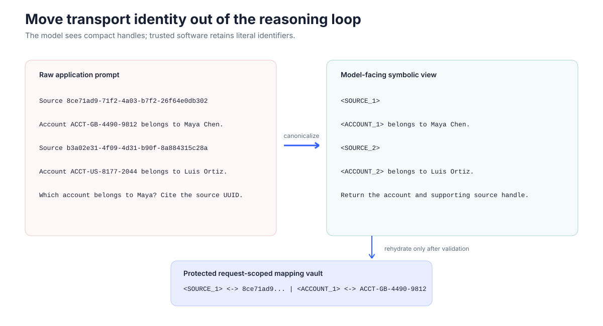
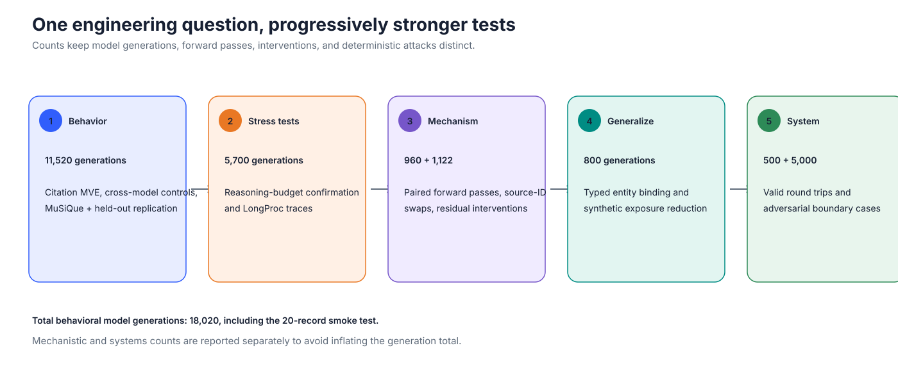
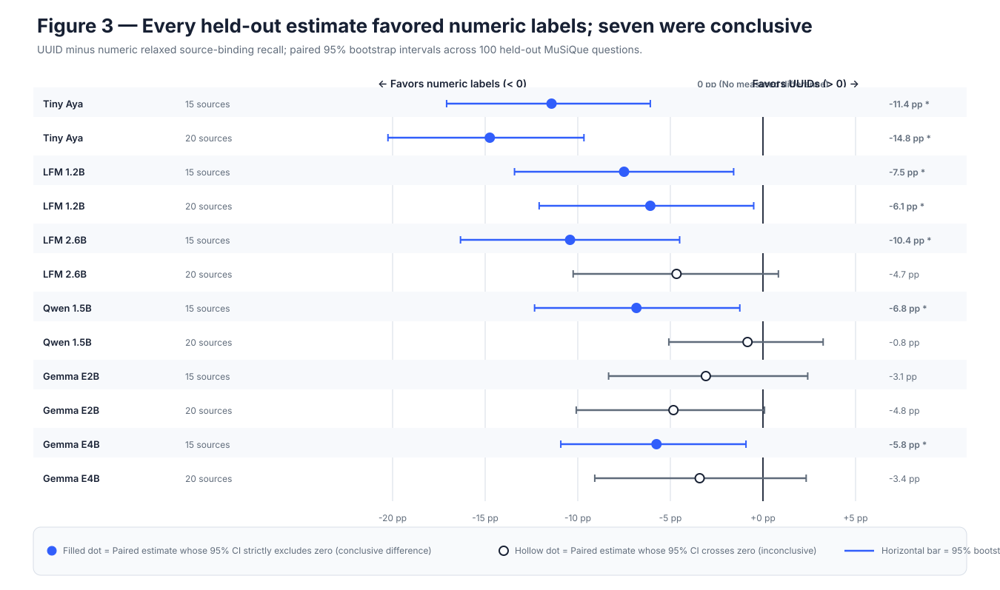
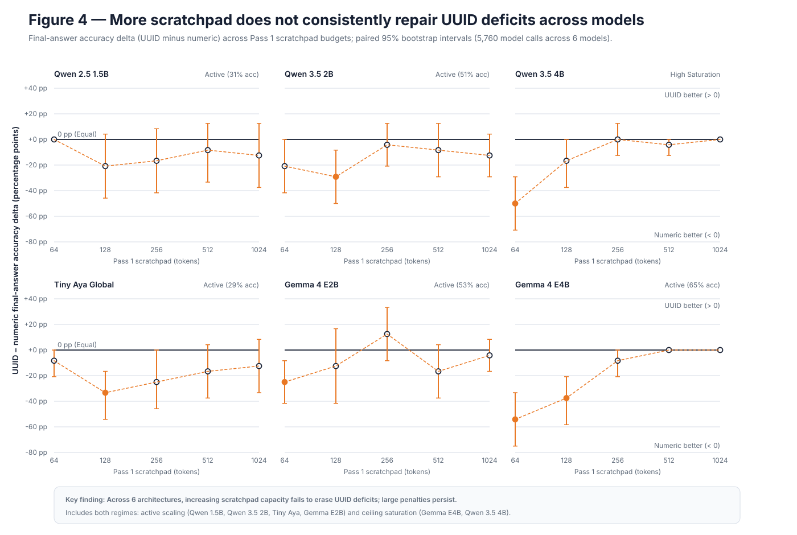
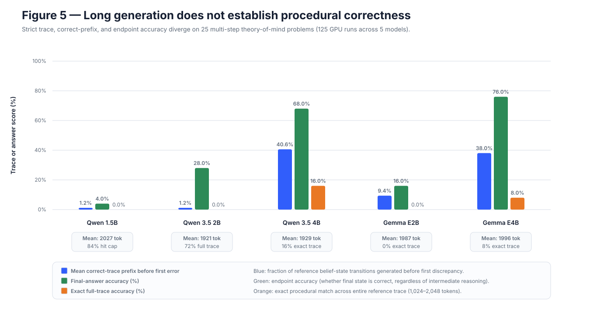
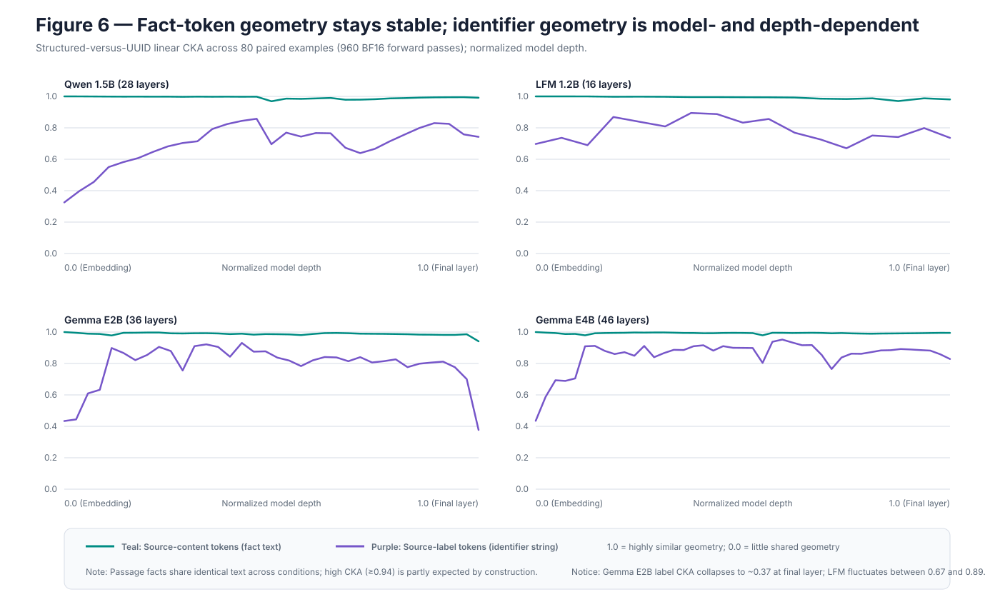
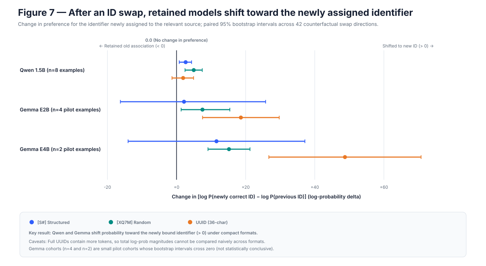
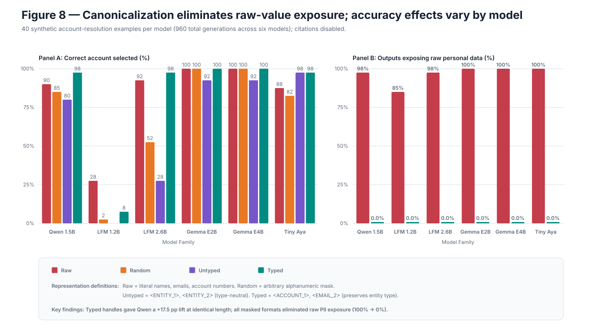
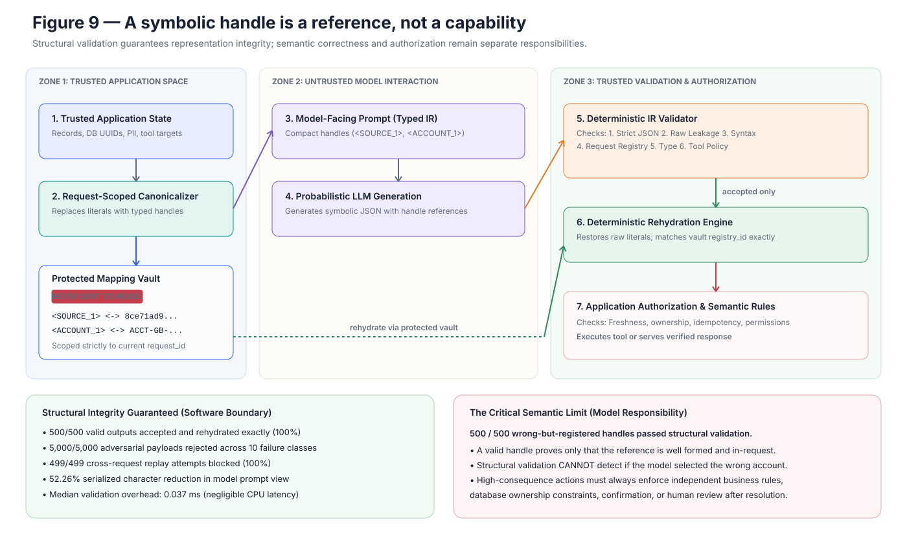

# The Hidden Cost of UUIDs: Building a Symbolic IR for LLM Systems

Modern LLM applications routinely place machine-generated identifiers directly
inside prompts: document UUIDs, database keys, account numbers, transaction IDs,
URLs, tool-call IDs, and workflow handles. Those strings are convenient for the
application because they already exist. That does not mean they are a good
reasoning interface for the model.

Consider a retrieval prompt containing this source label:

```text
8ce71ad9-71f2-4a03-b7f2-26f64e0db302
```

The model must attend to it, distinguish it from similar strings, preserve its
binding to a passage, and reproduce it at the end. Yet its literal characters
usually contribute nothing to answering the question. The application could
instead show `<SOURCE_1>` and keep the reversible mapping outside the model.

That small interface change motivated a much larger investigation. We ran
18,020 model generations across citation, multi-hop retrieval, reasoning-budget,
long-output, and entity-resolution tasks. We then added 960 paired hidden-state
passes, 66 counterfactual source-ID swaps, 1,056 activation interventions, and a
systems evaluation containing 500 valid round trips and 5,000 adversarial
outputs.

The result is not the simplistic claim that “short aliases make models smarter.”
The stronger and more useful conclusion is this:

> Keep a literal value in model context when its characters are part of the
> problem. Otherwise, expose a compact request-scoped handle, validate the
> symbolic response, and resolve it in trusted software.



## The actual hypothesis

Canonicalization could help for several different reasons, and conflating them
would make the experiments hard to interpret.

First, there is a straightforward **transport cost**. A UUID may occupy roughly
30 tokens where a short alias occupies three or four. Repeating twenty of them
through a prompt changes context length, prefill work, output length, and the
chance of a literal copying error.

Second, there is a **binding problem**. The model must associate a fact with the
right source or entity. Identifier surface form might make that association
easier or harder even when the underlying content is identical.

Third, there is a **reconstruction problem**. The model may know which source it
wants but fail to reproduce the required string or wrapper. A citation evaluator
that treats `S7` and `[S7]` as entirely different answers can mistake a formatting
failure for an evidence-selection failure.

Finally, there is a possible **reasoning-budget problem**. Under a fixed output
budget, identifier bookkeeping might compete with task reasoning. This was the
most ambitious hypothesis—and, importantly, the one that did not generalize
cleanly.

The experiments were designed to pull those mechanisms apart rather than report
one undifferentiated accuracy number.



## Making the comparison trustworthy

The central experimental unit was not a prompt string. It was a canonical
example containing semantic source keys, passages, questions, answers, and gold
evidence. Identifier renderers were applied afterward. That allowed the same
example, source order, and task content to be shown with numeric labels,
structured labels, random compact strings, hexadecimal strings, UUIDs, or typed
entity handles.

Every completed local-model run used deterministic decoding and a pinned model
revision. Native tokenizers measured each representation rather than relying on
a common approximation. The runner wrote append-only JSONL records containing
the complete prompt, mapping, raw response, evaluation, latency, token usage,
model metadata, configuration digest, and stable request key. Re-running an
experiment resumed it instead of silently overwriting it.

The evaluator deliberately separated:

- answer correctness;
- strict citation syntax;
- relaxed source binding;
- identifier reconstruction;
- malformed or invented identifiers;
- raw-value exposure;
- and, for LongProc, the correct prefix of an intermediate state trace.

Paired bootstrap intervals used the same semantic examples on both sides of a
comparison. Confirmatory cohorts were selected independently from the pilots.
That detail matters because many apparent identifier effects disappear when
content, source order, or example difficulty is allowed to change with the
condition.

## The first result: UUIDs are expensive

The first minimum viable experiment compared structured labels such as `[S1]`
with UUIDs on a fictional citation task. Qwen2.5-1.5B saw 100 paired examples at
five sources and another 100 at twenty sources under each representation.

At five sources, exact source binding was 96% with structured labels and 63%
with UUIDs. At twenty sources it was 66% versus 37%. Answer content, however,
was almost unchanged: 100% versus 98% at five sources and 90% versus 92% at
twenty. The representation changed the model’s ability to return the right
reference much more than its ability to recover the answer.

The cost difference was just as visible. At twenty sources, Qwen’s UUID prompt
used 1,237 input tokens versus 639 for structured labels, produced 46.5 output
tokens versus 14.8, and took 12.0 seconds versus 5.3 on the original CPU run.

The early cross-model replication complicated the behavioral story. Qwen and
LFM bound compact labels more reliably; Gemma E2B initially favored UUIDs; Gemma
E4B was at ceiling for both. But the efficiency result did not depend on that
behavioral disagreement. Across the four models at twenty sources, UUIDs added
roughly 70–94% input tokens and 77–129% latency.

That distinction became a theme of the project: canonicalization can be a sound
systems optimization even when its accuracy effect is architecture-dependent.

## The metric trap

The same first experiment also produced a result that looked contradictory. At
twenty sources, Qwen’s **strict** citation score was 7% for structured labels and
34% for UUIDs—even though relaxed source binding was 66% versus 37% in the other
direction.

The model often selected the right structured source but emitted `S7` instead
of `[S7]`. The strict metric classified that as fully wrong. UUIDs were harder to
select and reconstruct, but when a UUID was emitted it more often preserved the
expected wrapper.

The project therefore treated citation generation as a pipeline:

```text
solve the question
    -> select the supporting evidence
    -> bind evidence to its identifier
    -> reconstruct the identifier string
    -> emit the required syntax
```

This is more than an evaluation nicety. Each failure suggests a different
engineering response. A selection failure may require better retrieval or a
stronger model. A reconstruction failure may be eliminated by moving backend
identifiers outside the prompt. A wrapper failure belongs in a parser or
structured-output layer, not in the factuality score.

An exploratory family sweep reinforced the difference. At twenty sources,
Qwen’s exact binding declined from 85% with numeric labels to 80% with semantic
labels, 70% with random compact labels, 65% with six-character hexadecimal
labels, 45% with 32-character hexadecimal labels, and 40% with UUIDs. Identifier
length and binding had a descriptive Spearman association of -0.72 in that small
seven-family pilot.

But a token-matched comparison between `[1]` and `[S1]` showed why length alone
was not a sufficient explanation. Both averaged 3.55 tokens per identifier and
639 input tokens. Numeric labels beat structured labels by 67 percentage points
on strict citation formatting, yet the relaxed binding difference was only eight
points with an interval spanning zero. Most of the dramatic “advantage” was the
model preserving brackets around `[1]` while dropping them around `[S1]`.

The practical rule is simple: never publish one citation score without saying
whether it measures evidence selection, identifier reconstruction, or exact
surface formatting.

## Multi-hop retrieval: the effect survives a harder task

The next behavioral study moved to MuSiQue, a public multi-hop question-answering
dataset. One hundred balanced questions—34 two-hop, 33 three-hop, and 33
four-hop—were screened so that every prompt fit within 2,000–3,700 raw tokens
under all five native tokenizers. Each model completed 1,500 generations across
three stages, for 7,500 outputs total.

Stage 2 varied numeric, random compact, long hexadecimal, and UUID identifiers
at 15 and 20 passages. Stage 3 introduced length-matched structural controls such
as `[S#]`, `[X#]`, `<SOURCE_#>`, and `<ENTITY_#>`. Stage 4 separated four cases:

1. compact alias only, citation required;
2. UUID present and reproduced;
3. UUID present but no citation required;
4. UUID present with a compact citation alias.

Across the original MuSiQue cohort, relaxed source-binding recall was lower with
UUIDs in all ten numeric-versus-UUID model/source-count comparisons. Seven of
the ten paired intervals excluded zero. Answer-F1 differences all had intervals
spanning zero.

Strict citation F1 again told a noisier story. Tiny Aya appeared to favor UUIDs
because it frequently omitted brackets around numeric citations. Relaxed binding
reversed that conclusion: numeric labels led UUIDs by 9.2 points at 15 sources
and 13.7 points at 20.

The failure controls showed that reproduction can consume useful capacity. When
UUIDs remained in the prompt but did not have to be emitted, answer F1 improved
by 3.5 points for LFM and 5.1 points for Gemma E4B. Merely adding a short alias
next to each UUID did not reliably recover alias-only behavior. Showing both
representations still asks the model to encode and disambiguate both.

We then repeated the primary numeric-versus-UUID comparison on a disjoint,
balanced set of 100 MuSiQue questions: 2,000 more deterministic generations.
UUID binding recall was lower in all ten model/source-count cells, and six paired
95% intervals excluded zero in the negative direction.



This is the strongest behavioral result in the project. It is consistent in
direction across five architectures, two context sizes, and a held-out cohort.
It still does not imply that UUIDs always lower answer accuracy. They primarily
made evidence tracking and reference realization less reliable.

## The reasoning-budget hypothesis did not generalize

The initial theory predicted an interaction: if opaque identifiers consume
bookkeeping capacity, their accuracy penalty should be largest under a tight
reasoning budget and shrink as more scratchpad tokens become available.

Stage 5 tested that prediction with a two-pass design. The first pass received
the 2K–4K-token source prompt and a visible scratchpad cap of 64, 128, 256, 512,
or 1,024 tokens. The second pass received only that scratchpad and a fixed
128-token answer budget. This manipulated observable output capacity; it did not
claim access to proprietary hidden reasoning tokens.

The five-model pilot contained 2,400 generations. A separately seeded
confirmation added 3,200 generations and retained only task/model cells that met
a predeclared 30–70% pilot calibration rule.

The broad monotonic prediction failed. Every confirmatory slope and low-to-high
interaction interval included zero. Qwen retained significant UUID deficits at
128 and 1,024 tokens, but not a smooth recovery curve. Gemma E2B failed badly
with UUIDs at 64 tokens, then reversed non-monotonically; removing UUID
reproduction improved its accuracy by 45 and 50 points at the 512- and
1,024-token budgets. Tiny Aya’s positive pilot slope did not replicate.



One cost did survive: UUIDs increased total generated output in 14 of 15
confirmatory model-budget cells. The direction of scratchpad-token use was
model-dependent, so the data support a reconstruction and output-cost claim—not
a universal theory that UUIDs consume a fixed quantity of reasoning.

This negative result narrowed the project in a productive way. The final system
does not depend on speculative reasoning-token savings. It depends on directly
measured transport cost, binding reliability, output burden, and exposure
reduction.

## Long output is not evidence of correct reasoning

LongProc provided a separate stress test. Twenty-five matched theory-of-mind
tracking problems required deterministic belief-state traces of 1,024–2,048
reference tokens. Four models produced 100 GPU generations with an 8,192-token
context and a 2,048-token output cap.

Gemma E4B was clearly strongest: 38.0% mean correct-prefix accuracy, 76% final
answer accuracy, and two completely correct traces. Gemma E2B reached 9.4%
correct-prefix accuracy and no exact traces.

Qwen illustrates why output length is a poor proxy for reasoning. It produced a
mean of 2,027 tokens and hit the cap on 84% of examples, yet its mean correct
prefix was only 1.2%. LFM looked extremely fast because it emitted only 434
tokens on average and never completed a trace.



Even for Gemma E4B, 76% endpoint accuracy coexisted with only 8% exact trace
accuracy. If an application cares about procedural state, evaluating only the
final answer can hide nearly all of the interesting failures.

## Inside the model: stable facts, late surface realization

Behavioral results cannot tell us whether a model internally represents the same
source similarly across identifier formats. Stage 6 recorded hidden states from
official BF16 Qwen, LFM, Gemma E2B, and Gemma E4B checkpoints. Each model saw the
same 80 semantic examples under structured, random compact, and UUID formats,
for 960 paired forward passes.

Three patterns replicated across all four models.

First, source-content geometry was largely format-invariant: the minimum
cross-format source-fact CKA ranged from 0.941 to 0.979. Second, source-label
geometry began farther apart at the embedding layer but converged substantially
inside the stack. Third, states near citation generation became more
format-specific late in the model, while question representations remained
highly similar.



That is consistent with a model maintaining similar semantic facts while
realizing different identifier strings near the output. But the likelihood
results warned against a single universal copying story. UUID answer likelihood
was worse in Gemma E2B, UUID citation likelihood was worse in LFM, and UUID
citation likelihood was actually better in Qwen and Gemma E4B under the
teacher-forced measure.

Representation similarity is correlational. Stage 7 therefore changed the
source-to-identifier relationship and tested whether the model followed it.

For each semantic example, the identifier assigned to one relevant source was
swapped with a distractor while source text, identifier set, question, and answer
remained fixed. A positive direct effect means the model shifted probability
toward the relevant source’s newly assigned identifier.

Qwen followed the source to its new compact identifiers. The smaller Gemma
pilots also showed correct rebinding. LFM was causally sensitive but moved in the
opposite direction: its compact-ID condition significantly strengthened the old
association.



Residual-stream patching located a second shared property. Final-layer citation
state patches transferred approximately the full prompt-swap response in every
model, confirming that a causally effective representation of the output choice
was present by the end. The onset differed sharply: Qwen already transferred
74–108% at layer 24; Gemma E2B showed partial UUID transfer at layer 29; Gemma
E4B’s sampled layer 32 barely transferred UUID behavior and moved short IDs in
the wrong direction. Patching one source-label endpoint or one fact span was far
less consistent than patching the citation-generation trajectory.

The mechanistic conclusion is deliberately bounded. Semantic source tracking
and literal identifier realization are often separable, but similar
cross-format geometry does not imply that different model families implement
the same causal binding algorithm.

## Generalizing beyond citations

If canonical structure only helped citation formatting, it would be a narrow
result. Stage 8 removed citations entirely and tested synthetic account
resolution. Forty semantic examples containing 15 or 20 records were rendered
four ways:

- raw names, emails, and account values;
- arbitrary masked values;
- untyped canonical handles;
- typed handles such as `<EMAIL_2>` and `<ACCOUNT_3>`.

Source labels were fixed across all conditions. Five models produced 800
generations.

Qwen reached 97.5% accuracy with typed handles versus 80.0% with untyped
handles—a 17.5-point paired gain with exactly identical input-token counts. Tiny
Aya’s typed handles beat arbitrary masking by 15 points with near-matched length.
The two Gemma models were ceiling-limited; LFM was near floor after masking.



Across all 200 model/example pairs, typed handles beat untyped handles by eight
points with no paired typed losses, but that pooled number should not erase the
architecture differences. The defensible claim is that typed canonicalization
can improve non-citation binding after controlling for length—not that it always
will.

Every masked-condition output avoided all synthetic raw names, emails, and
account numbers because those values were removed before inference. That is
useful exposure reduction. It is not anonymization: surrounding facts can remain
identifying, the mapping vault is reversible, and the provider still sees the
canonicalized context.

## From experiment to system boundary

The behavioral and mechanistic evidence suggests an application architecture,
but it also establishes its limits. Stage 9 implemented that boundary as a
request-scoped typed IR.

Trusted application code canonicalizes fields according to an explicit schema.
The model receives compact typed handles and returns strict symbolic JSON. A
validator checks the schema, raw-value leakage, handle syntax, request registry,
field type, tool name, argument schema, argument types, and action-count policy.
Only accepted output can be rehydrated, and the resulting object still passes
through the application’s normal authorization and side-effect layer.

```json
{
  "answer": "<ACCOUNT_3>",
  "references": ["<SOURCE_7>"],
  "actions": [
    {"name": "lookup_account", "arguments": {"account": "<ACCOUNT_3>"}}
  ]
}
```

The operational evaluation created 500 synthetic requests with 20 records each.
All 500 valid outputs were accepted and rehydrated exactly. All 5,000 adversarial
outputs across ten failure classes were rejected, including malformed and
unknown handles, raw exposure, schema extensions, type confusion, unauthorized
actions, invalid argument schemas, excessive action counts, and duplicate
references. All 499 possible cross-request rehydration attempts were blocked.

The canonical model view used 52.26% fewer serialized characters than the raw
state and instruction. Median canonicalization took 3.51 ms and median
validation 0.037 ms on the measured synthetic Python workload. Those are
experiment timings, not deployment service-level objectives.



The most important Stage 9 result is the one the validator could not catch. In
500 deliberately constructed cases, the output contained the wrong account
handle—but it was a well-formed handle registered to the current request. Every
case passed structural validation and rehydrated to the wrong account.

That behavior is not a bug in the validator. It marks the semantic boundary:

```text
malformed or unknown handle
    -> deterministic validation can reject it

known but semantically wrong handle
    -> requires task verification, business rules, confirmation, or review
```

A handle is a reference, not a bearer token, permission, or proof that the
model chose the correct object.

## An engineering decision rule

Canonical handles are a strong fit when the literal value is merely transport
identity: retrieval IDs, database keys, UUIDs, transaction IDs, tool results,
account references, email addresses used only as identity, or URLs used only as
opaque object keys.

Keep or selectively expose the literal when its characters carry task meaning:
classifying an email domain, comparing URL paths, validating a checksum, editing
code, inspecting morphology, preserving legal text, or reasoning about a
substring. A mixed representation is often correct. Alias the account number
while preserving the transaction amount; alias the source ID while preserving
the quoted passage.

For production RAG and agent systems, the evidence supports the following
pattern:

1. Canonicalize only fields whose surface form is irrelevant.
2. Keep the reversible map outside model context and ordinary logs.
3. Bind handles to request and tenant identity with a short lifecycle.
4. Ask for strict structured output rather than free-form identifier copying.
5. Validate schema, leakage, registry membership, type, and action policy.
6. Rehydrate only validated outputs.
7. Re-check authorization, object freshness, idempotency, ranges, and business
   rules after resolution.
8. Require user confirmation or an independent verifier for consequential
   wrong-target risk.
9. Evaluate answer quality, source selection, and surface formatting separately.
10. Benchmark every representation on the actual model and task family.

## What remains uncertain

These experiments use small local models, several of them quantized. Decoding is
deterministic, and most behavioral studies use one assignment/order seed.
Paired intervals quantify example variation, not every source of deployment
variance. The Gemma causal cohorts are small pilots. The entity study is
synthetic. The reference IR has not been integrated with a production identity
system, retriever, database, encrypted vault, or tool executor.

The next mechanistic step is component-level patching in the architecture-specific
transition regions: Qwen layers 20–24, LFM 6–13, Gemma E2B 29–35, and Gemma E4B
33–42. The next systems step is external validation against a real retrieval or
agent workflow with independent authorization and semantic checks.

The project nevertheless resolves the original engineering question well enough
to change a design. Backend identifiers should not enter model context simply
because they are available. The right boundary is semantic:

> If the literal characters are part of the problem, preserve them. If they are
> only a transport key, replace them with a compact typed handle and make
> deterministic software own the mapping, validation, and authorization.

---

The complete experiment matrix, metric definitions, model and dataset
provenance, limitations, and reproduction commands are in the
[technical appendix](appendix.md). The machine-readable claim inventory is in
[`evidence_manifest.csv`](evidence_manifest.csv), and all figures are generated
from checked-in result artifacts by [`scripts/build_figures.py`](scripts/build_figures.py).
