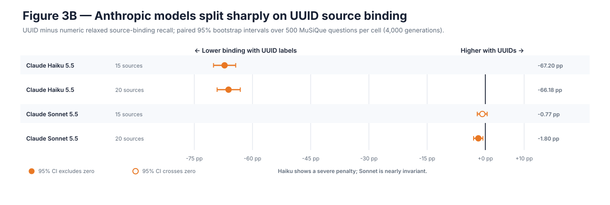
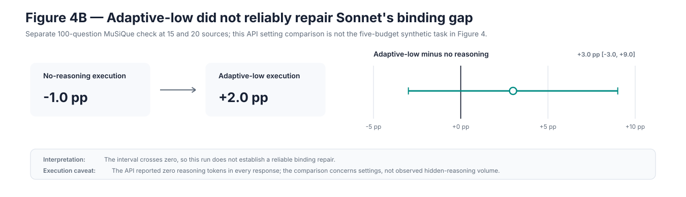

# The Hidden Cost of UUIDs: Building a Symbolic IR for LLM Systems

**Author:** Sudo Mishra (Symbolic IR Project)  
**Date:** October 2026  
**Repository:** [github.com/SudoMishra/Symbolic-IR-Mechanistic](https://github.com/SudoMishra/Symbolic-IR-Mechanistic)

Modern LLM applications routinely place machine-generated identifiers directly inside prompts: document UUIDs, database primary keys, account numbers, transaction hashes, tool-call IDs, and workflow handles. Because these strings already exist in backend databases, engineers treat the LLM context window as a transparent transport pipe.

That assumption is expensive and fundamentally flawed. An autoregressive language model is not a relational database index. It is a probabilistic token predictor with finite attention capacity and tokenization constraints. Passing high-entropy, opaque strings forces the model to encode, track, and reproduce meaningless characters—often degrading attribution accuracy and inflating latency.

This engineering report synthesizes a comprehensive empirical investigation: an initial baseline program of **21,397 baseline behavioral records (27,706 model calls)** across initial behavioral stages (including an initial 20-record end-to-end smoke test, with 2,880 two-pass records accounting for 5,760 calls in Stage 5), augmented by 36,000 scaled $N=500$ generations across Stages 1, 8, and MuSiQue for a local-fleet total of **57,397 behavioral records and 63,706 model calls**, plus **6,400 completed Anthropic API generations** reported separately below, alongside **720 paired hidden-state passes**, **714 causal interventions** (42 counterfactual swaps and 672 activation patches), and **5,000 adversarial tests** of a deterministic symbolic boundary.

The central thesis is not the naive claim that “short aliases make models smarter.” The defensible, systems-grounded rule is:

> **Keep a literal value in model context when its characters are part of the problem. Otherwise, expose a compact request-scoped symbolic handle, validate the model’s symbolic output, and rehydrate it in trusted software.**


> **Figure 1 — Representation boundary between software and model.** This figure shows a representation boundary, not a new reasoning algorithm. The application begins with literal database identifiers and potentially sensitive values. Before constructing the prompt, trusted software replaces those values with request-scoped handles such as `<SOURCE_1>` and records the reversible mapping in a protected vault. The model sees the same semantic facts but not the backend identifiers. Its symbolic response is validated before trusted software uses the vault to restore the original values. Canonicalization controls representation and exposure; it does not prove that the model selected the correct record or had permission to act on it.

---

## PART I: THE SETUP & THE METRIC TRAP

### Opaque Literals in Context

To see the problem clearly, consider what happens when a standard retrieval-augmented generation (RAG) system feeds retrieved documents to a model:

```text
=== RAW APPLICATION PAYLOAD (High-Entropy Backend Literals) ===
Source 8ce71ad9-71f2-4a03-b7f2-26f64e0db302:
Account ACCT-GB-4490-9812 belongs to Maya Chen. Contact: maya.chen@internal.corp.

Source b3a02e31-4f09-4d31-b90f-8a884315c28a:
Account ACCT-US-8177-2044 belongs to Luis Ortiz. Contact: luis.ortiz@internal.corp.

Question: Which account belongs to Maya Chen? Cite the source document UUID.
```

Under the native tokenizers used in these experiments, UUID identifiers averaged roughly **25 to 35 tokens**. A representative segmentation looks like this:

```text
["8", "ce", "71", "ad", "9-", "71", "f", "2-", "4a", "03-", "b", "7f", "2-", "26", "f", "64", "e0", "db", "30", "2"]
```

Now compare this with an **Intermediate Representation (IR)** using request-scoped symbolic handles:

```text
=== SYMBOLIC MODEL VIEW (Typed Request-Scoped Handles) ===
<SOURCE_1>:
<ACCOUNT_1> belongs to Maya Chen. Contact: <EMAIL_1>.

<SOURCE_2>:
<ACCOUNT_2> belongs to Luis Ortiz. Contact: <EMAIL_2>.

Question: Which account belongs to Maya Chen? Return the account and supporting source handle.
```

Across the tested tokenizers, `<SOURCE_1>` averaged roughly **5.5 to 6 tokens**. Across 20 retrieved passages, UUIDs add hundreds of tokens of high-entropy noise to prefill, consume KV-cache memory, risk literal copying errors at the output head, and needlessly expose internal database identifiers and personal data to the model.

### The Core Engineering Questions

We set out to answer three concrete questions:
1. **The Transport Question:** How much do opaque identifiers inflate input tokens, output tokens, and end-to-end generation latency?
2. **The Attribution Question:** Does identifier surface form actively degrade the model’s ability to bind facts to sources, even when task content and source order are held identical?
3. **The System Boundary Question:** Can a lightweight, deterministic software layer manage the mapping outside model context, validate symbolic responses, and guarantee representation integrity?

### Experimental Design: Paired by Construction

To measure representation effects without confounding them with content difficulty, our harness enforced strict controls:

- **Canonical Semantic Units:** Prompts were never authored as isolated strings. Each example was generated as a canonical object (question, passages, gold answer, gold source keys) and rendered into target identifier families (*numeric* `[1]`, *structured* `[S1]`, *random compact* `[XQ7M]`, *long hex*, *UUID*, and *typed entity handles*) only at inference time.
- **Identical Sequence Order:** Within every paired comparison, passage order, question phrasing, and distractor sets were identical.
- **Native Tokenizer Accounting:** Input and output lengths were logged using each model's native tokenizer, rather than character approximations.
- **Pinned Model Revisions & Deterministic Decoding:** All behavioral runs used temperature 0 decoding against pinned local GGUF models across six primary edge model configurations (1.5B to 4B parameters) spanning three distinct architectural families:
  - **Qwen family:** Qwen2.5-1.5B-Instruct (`91cad511`), Qwen3.5-2B-Instruct (`f6d5376b`), Qwen3.5-4B-Instruct (`e87f1764`)
  - **Google Gemma family:** Gemma 4 E2B Instruct (`675cff42`), Gemma 4 E4B Instruct (`4b4a2c1d`)
  - **Cohere Tiny Aya family:** Tiny Aya Global 3.35B (`a602ea7e`)
- **Scale:** The dataset comprises **21,397 baseline behavioral records (27,706 model calls)** across initial behavioral stages (including an initial 20-record end-to-end smoke test, with 2,880 two-pass records accounting for 5,760 calls in Stage 5), augmented by 36,000 scaled $N=500$ generations across Stages 1, 8, and MuSiQue for a local-fleet total of **57,397 behavioral records and 63,706 model calls**. A completed Anthropic frontier extension adds **6,400 API generations** across MuSiQue, reasoning, and entity-resolution protocols. The program also includes 720 BF16 hidden-state passes, 714 causal interventions (42 counterfactual swaps and 672 activation patches), and 5,000 adversarial test cases.


> **Figure 2 — Experimental evidence program across five testing regimes.** This figure summarizes the evidence program and keeps different kinds of observations separate. The behavioral stages measure what models generate under controlled identifier formats. The stress tests ask whether additional scratchpad budget or verbose reasoning repairs the problem. The mechanistic stages inspect internal representations and intervene on them, without counting those forward passes as behavioral generations. The entity-resolution stage tests whether the idea generalizes beyond citations. Finally, the system stage evaluates deterministic software rather than model intelligence. The stages therefore strengthen different parts of the argument and should not be combined into one inflated sample count.

### What Each Experiment Is Trying to Do (The 9 Stages)

To systematically decouple transport overhead, attribution fidelity, cognitive capacity, and systems security, the investigation progressed through nine distinct stages across five testing regimes:

| Stage / Experiment | Core Question & Motivation | What We Did & Controlled | Data & Benchmark Used |
|:---|:---|:---|:---|
| **Stage 1: Controlled Synthetic Baseline** | *Does replacing compact keys with UUIDs degrade attribution even when factual content and prompt order are identical?* | Tested Qwen, Gemma, and Tiny Aya across 5 vs. 20 retrieval passages in an initial 100-item pilot and a definitive 12,000-generation scaled replication ($N=500$). | Synthetic single-hop citation corpus (`src/symbolic_ir/data/citations.py`); 100-item pilot (2,500 candidate passages) and 500-item scaled benchmark (12,500 candidate passages) across 5 & 20 passages. |
| **Stages 2 & 3: MuSiQue Multi-Hop & Held-Out Confirmation** | *Does the UUID binding penalty survive real multi-hop reasoning, or was Stage 1 an artifact of synthetic questions?* | Evaluated 6 models on 100 balanced multi-hop MuSiQue questions (Stage 2), followed by a 100-item held-out confirmatory cohort (2,400 gen) and a definitive 12,000-generation scaled confirmatory benchmark ($N=500$). | Official MuSiQue dev split (`musique_ans_v1.0_dev.jsonl`, CC-BY-4.0); 100-item primary cohort, 100-item held-out cohort, and 500-item scaled benchmark (34/33/33 hop distribution; 2,000–3,750 tokens). |
| **Stage 4: Dual-Label Ablation** | *Can engineers fix UUID degradation cheaply by keeping raw UUIDs in context and appending short aliases next to them?* | Tested dual labels (`Source <UUID> [S1]`) against alias-only, UUID-only, and no-citation conditions across 15 and 20 sources across models. | Stage 2 MuSiQue 100-question multi-hop cohort at 20 retrieval passages per question (2,000 candidate passages). |
| **Ablation 1: Length vs. Bracket Priors** | *Is attribution loss driven by token length, tokenizer/prior bias around bracket characters, or generation-time literal emission?* | Compared token-matched `[1]` vs. `[S1]` (identical length: 3.55 tokens) and ran a no-reproduction control removing citation emission. | Stage 1 20-source citation corpus (100 items; 2,000 candidate passages) formatted under matched numeric vs. structured labels. |
| **Stage 5: Reasoning Budget Scaling** | *If UUIDs consume internal bookkeeping capacity, can giving models a larger scratchpad monotonically erase the penalty?* | Tested 2,880 two-pass records (5,760 model calls) across 6 models over 5 visible scratchpad budgets (64 to 1,024 tokens) to check for monotonic recovery. | Synthetic multi-source reasoning suite (`data/reasoning/`: arithmetic, temporal, constraint, entity resolution; 2,000–4,000 tokens); 6 models evaluated across 5 budgets. |
| **LongProc Reality Check** | *Does verbose output indicate sound multi-step deduction, or can models generate thousands of tokens while losing state?* | Evaluated 25 belief-state instances with deterministic reference traces across 5 models (125 GPU runs), measuring correct prefix, final-answer accuracy, and full trace accuracy. | Official Princeton PLI LongProc ToM benchmark (`LongProc/tom_tracking_2k`, Apache-2.0); 25 belief-state tracking instances with 1,024–2,048 token reference traces across 5 models. |
| **Stage 6: Representation Geometry (Linear CKA)** | *Where inside the transformer does attribution break down? Do UUIDs distort semantic fact tokens or only identifier states?* | Extracted residual-stream states across 720 paired BF16 passes (80 examples across 3 models) and computed Linear CKA across normalized network depth. | Residual-stream hidden states from 80 paired semantic examples (temporal & entity resolution) across 15 & 20 sources from the calibrated Stage 5 suite. |
| **Stage 7: Counterfactual ID Swaps & Patching** | *Does shared geometry imply shared causal circuits, and at which layer does the model lock in its source-binding decision?* | Executed 42 counterfactual identifier swaps and 672 residual activation patches across 3 models to identify model-specific onset layers. | 42 counterfactual prompt examples with single-source ID swaps and 672 residual-stream activation patch interventions across donor and recipient passes. |
| **Stage 8: Cross-Domain Entity Resolution** | *Does request-scoped canonicalization help tasks outside citations, and does it eliminate sensitive data exposure?* | Evaluated customer account resolution under Raw, Random, Untyped, and Typed formats across 6 models in pilot (960 gen) and scaled benchmark (12,000 gen; $N=500$). | Synthetic customer support account dataset (`src/symbolic_ir/data/pii.py`) with realistic PII fields (name, email, phone, address, accounts; 40-item pilot and 500-item scaled benchmark). |
| **Stage 9: Systems Boundary & Stress Testing** | *Can deterministic software guarantee representation integrity without fine-tuning, and where is its semantic boundary?* | Tested `ModelIR` and `MappingVault` against 5,000 adversarial payloads across 10 failure classes and 500 semantic bypass cases. | Deterministic banking and database request payloads: 500 valid round trips, 5,000 adversarial payloads across 10 failure classes, and 500 semantic bypass cases. |

### The Citation Metric Trap

Our initial tests revealed an immediate trap in citation evaluation. When we tested Qwen2.5-1.5B on 20-source prompts, its **strict citation accuracy** was **7% for structured labels `[S1]` versus 34% for UUIDs**. 

On the surface, it looked like UUIDs performed five times better. But inspecting the raw outputs revealed the mismatch: Qwen selected the correct structured source in **66%** of cases, but often emitted `S7` instead of `[S7]`. Because strict evaluation requires exact character matching of the enclosing brackets, the evaluator marked those citations wrong. With UUIDs, the model selected the right source less often, but copied the prompt's formatting wrapper more reliably when it did.

To prevent surface syntax from masquerading as reasoning failure, we decomposed citation evaluation into a multi-stage pipeline:

```text
Solve problem → Select evidence → Bind to handle → Reconstruct literal → Format syntax
```

Throughout this work, we report separate metrics:
- **Answer Exact Match / F1:** Does the model produce the correct answer string?
- **Relaxed Source Binding:** Does the emitted identifier map back to the gold source in the mapping vault, tolerating surface formatting variations (e.g., omitted brackets)?
- **Strict Citation:** Requires exact identifier reconstruction AND exact syntax wrapper matching.
- **Surface-Only Failure:** The model selected the correct source, but violated the requested wrapper or casing.

> **Takeaway for evaluators:** Never publish a single citation metric. If you do not decouple semantic evidence selection from surface wrapper formatting, you are measuring bracket retention, not model factuality.

### Grounding in Related Work

This investigation connects three previously disparate threads in ML systems:
1. **Binding IDs in Transformers:** Feng & Steinhardt (2023) demonstrated that transformers track entities across long contexts by binding them to identifier tokens. Our work tests how identifier entropy and tokenization boundaries interact with that binding mechanism in production retrieval.
2. **Citation Evaluation:** The ALCE benchmark (Gao et al., 2023) established standard citation recall and precision metrics for RAG. Our metric decomposition directly addresses ALCE’s vulnerability to surface formatting discrepancies.
3. **Symbolic Trust Boundaries & Untrusted Views:** The CaMeL framework (Debenedetti et al., 2025) and the Dual-LLM pattern (Willison, 2023) propose isolating untrusted data and privileged tools. Our reference architecture applies the same separation principle: a request-scoped mapping vault reduces literal exposure and rejects malformed symbolic outputs. It does not make retrieved content trustworthy or neutralize prompt injection.

---

## PART II: THE BEHAVIORAL EVIDENCE (SYNTHETIC TO MULTI-HOP)

### Controlled Baseline: Qwen 5 vs. 20 Sources (Stage 1)

> **Stage 1 Motivation:** Before evaluating complex pipelines, we need to establish an uncontaminated behavioral baseline under laboratory conditions: *When we manipulate only the identifier surface form—holding factual text, question wording, and distractor sets identical—how much do high-entropy UUIDs inflate token counts, increase latency, and degrade attribution accuracy?*
>
> **Data Used:** A synthetic, single-hop factual citation corpus generated programmatically (`src/symbolic_ir/data/citations.py`). Each example contains a single gold factual sentence (`"In {city}, the primary export is {commodity}."`) surrounded by 4 or 19 plausible distractors. The benchmark comprises 100 paired questions tested at 5 sources (500 candidate passages) and another 100 paired questions tested at 20 sources (2,000 candidate passages). Distractor facts, prompt phrasing, and passage ordering are held deterministically identical across identifier conditions.

Our baseline experiment compared structured labels `[S1]` against full UUIDs across 100 paired questions at 5 sources, and another 100 at 20 sources:

| Sources | Identifier Type | Answer Accuracy | Strict Citation | Relaxed Source Binding | Mean Input Tokens | Mean Latency |
|:---:|:---|:---:|:---:|:---:|:---:|:---:|
| **5** | Structured `[S1]` | **100%** | 68% | **96%** | 234.6 | **1.74 s** |
| **5** | UUID | 98% | 29% | 63% | 385.5 | 4.36 s |
| **20** | Structured `[S1]` | 90% | 7% | **66%** | 639.3 | **5.27 s** |
| **20** | UUID | **92%** | **34%** | 37% | 1,237.4 | 11.96 s |

The results illustrate the core phenomenon:
1. **Answer accuracy is invariant:** At 20 sources, answer correctness was 90% vs. 92%—well within statistical parity. The model found the required fact regardless of identifier format.
2. **Relaxed binding degrades severely:** Relaxed source binding collapsed from **66% down to 37%** under UUIDs. The model knew the answer, but lost track of which document provided it.
3. **The Transport Tax is massive:** At 20 sources, UUIDs added **93.5% more input tokens** (1,237.4 vs. 639.3) and increased generation latency from **5.3 seconds to 12.0 seconds** on the local CPU runtime.

Across all four initial models at 20 sources, UUIDs imposed a **70% to 94% input token tax** and a **77% to 129% latency overhead**.

The binding result was not universal in pilot testing. Gemma E2B reversed the Qwen pattern in pilot evaluations: UUID binding exceeded structured-label binding by **37 points at five sources** and **25 points at twenty sources**, with both paired intervals excluding zero. Gemma E4B was at ceiling for both formats. That counter-result is why the later held-out MuSiQue study reports each model and source-count cell separately rather than claiming a universal accuracy advantage.

#### Large-Scale Evaluation: Stage 1 Across 6 Primary Models ($N=500$, 12,000 Generations)

To verify whether the Stage 1 baseline effects persist beyond the initial 100-item pilot cohort, we scaled the benchmark to a 500-example balanced cohort tested across the six primary fleet models (500 paired examples per condition across 5 and 20 sources, totaling **12,000 deterministic generations**):

| Model Family | Sources | Structured Content | UUID Content | Structured Strict | UUID Strict | Structured Binding | UUID Binding | Paired Binding Δ (95% CI) | Exact p |
|---|---:|---:|---:|---:|---:|---:|---:|---:|---:|
| **Qwen 1.5B** | 5 | 99.4% | 99.6% | 72.8% | 53.8% | 98.6% | 81.2% | **-17.4 pp** [-21.0, -14.0] | $1.68 \times 10^{-22}$ |
| **Qwen 1.5B** | 20 | 85.4% | 88.8% | 12.6% | 36.6% | 68.8% | 40.4% | **-28.4 pp** [-34.0, -22.6] | $6.14 \times 10^{-20}$ |
| **Qwen 3.5 2B** | 5 | 100.0% | 99.8% | 99.4% | 98.0% | 99.4% | 98.0% | -1.4 pp [-2.8, +0.0] | 0.0923 |
| **Qwen 3.5 2B** | 20 | 100.0% | 100.0% | 97.0% | 94.0% | 97.0% | 94.0% | **-3.0 pp** [-5.6, -0.4] | 0.0357 |
| **Qwen 3.5 4B** | 5 | 100.0% | 100.0% | 100.0% | 96.0% | 100.0% | 100.0% | +0.0 pp [+0.0, +0.0] | 1.0000 |
| **Qwen 3.5 4B** | 20 | 100.0% | 100.0% | 99.8% | 97.4% | 99.8% | 98.0% | **-1.8 pp** [-3.2, -0.6] | 0.0117 |
| **Gemma E2B** | 5 | 100.0% | 100.0% | 98.0% | 99.4% | 99.8% | 99.6% | -0.2 pp [-1.0, +0.4] | 1.0000 |
| **Gemma E2B** | 20 | 99.8% | 99.8% | 76.4% | 99.6% | 99.2% | 99.8% | +0.6 pp [-0.2, +1.6] | 0.3750 |
| **Gemma E4B** | 5 | 100.0% | 100.0% | 100.0% | 91.8% | 100.0% | 100.0% | +0.0 pp [+0.0, +0.0] | 1.0000 |
| **Gemma E4B** | 20 | 100.0% | 100.0% | 96.2% | 82.6% | 100.0% | 100.0% | +0.0 pp [+0.0, +0.0] | 1.0000 |
| **Tiny Aya** | 5 | 100.0% | 100.0% | 52.0% | 64.0% | 96.0% | 79.6% | **-16.4 pp** [-20.2, -12.6] | $3.30 \times 10^{-16}$ |
| **Tiny Aya** | 20 | 99.4% | 99.8% | 43.6% | 70.0% | 76.8% | 73.6% | -3.2 pp [-8.4, +2.0] | 0.2635 |

The scaled benchmark reveals a heterogeneous architectural landscape across the primary fleet:
1. **Vulnerable models gain substantially from compact aliases:** On Qwen 1.5B, the paired binding penalty widens from $-17.4\text{ pp}$ at 5 sources to **$-28.4\text{ pp}$ at 20 sources** ($p = 6.14 \times 10^{-20}$), and on Tiny Aya **$-16.4\text{ pp}$** ($p = 3.30 \times 10^{-16}$). On Qwen 3.5 2B, binding degrades by $-3.0\text{ pp}$ at 20 sources ($p = 0.0357$), and on Qwen 3.5 4B by $-1.8\text{ pp}$ ($p = 0.0117$) alongside syntax formatting drops of $-4.0\text{ pp}$ and $-2.4\text{ pp}$.
2. **High-capacity architectures saturate at ceiling:** Gemma E4B achieves perfect 100.0% source binding across both representations and scales (+0.0 pp), though UUID prompts cause strict citation formatting to fall by $-8.2\text{ pp}$ at 5 sources and $-13.6\text{ pp}$ at 20 sources ($p = 3.6 \times 10^{-13}$).
3. **Rescoring clarifies Gemma E2B:** Initial pilot evaluation appeared to show a large UUID advantage on Gemma E2B (+26.0 pp and +17.0 pp). Offline inspection revealed this was entirely a parser artifact: Gemma E2B frequently emitted `ANSWER: ..., CITATIONS: ...` on a single line under structured conditions (in 60.5% of 5-source outputs), which the initial line-based citation extractor discarded. Once the parser was updated to extract same-line citations, Gemma E2B achieved near-ceiling source binding under both formats: **$-0.2\text{ pp}$** [$-1.0, +0.4$] at 5 sources (99.8% vs 99.6%) and **$+0.6\text{ pp}$** [$-0.2, +1.6$] at 20 sources (99.2% vs 99.8%), with both intervals crossing zero. At 20 sources, structured strict citation was 76.4% due to bracket omissions (`S1` vs `[S1]`), but true evidence binding remained at ceiling.

### Skeptical Follow-Up: Does This Survive Real Multi-Hop Retrieval? (Stages 2 & 3)

> **Stages 2 & 3 Motivation:** Synthetic single-hop citation prompts isolate representation variables, but production retrieval involves noisy, multi-hop evidence. We set out to test: *Does the UUID source-binding deficit persist when queries require multi-step reasoning across 15 to 20 passages? And is it consistent across diverse model architectures, or was Stage 1 an artifact of a specific benchmark?*
>
> **Data Used:** Official development split of the **MuSiQue** multi-hop benchmark (`data/musique/musique_ans_v1.0_dev.jsonl`, CC-BY-4.0).
> - **Primary Matrix (Stages 2–4):** 100 balanced multi-hop questions (34 two-hop, 33 three-hop, and 33 four-hop queries) screened across all native GGUF tokenizers so every prompt is strictly bounded between 2,000 and 3,700 tokens across 15 and 20 retrieval passages (`configs/musique/musique_balanced_100.json`).
> - **Held-Out Confirmatory Cohort (Stage 3):** An independent, strictly disjoint set of 100 balanced MuSiQue dev questions (`configs/musique/musique_confirmatory_heldout_100.json`; seed 202603) with zero example overlap, preserving the identical 34/33/33 hop distribution and 2,000–3,700 token length constraints across 2,400 independent GPU generations.

To test this, we evaluated the models on **MuSiQue**, a challenging multi-hop benchmark. We filtered 100 balanced questions (34 two-hop, 33 three-hop, and 33 four-hop examples) screened so that every prompt fell within 2,000 to 3,700 tokens across all native tokenizers. We tested across 15 and 20 retrieval passages.

Across the initial 7,500 generations (MuSiQue Stages 2–4), UUID relaxed source binding recall was lower in all 10 model/source-count cells. 

To ensure this was not an artifact of example selection, we drew a **completely disjoint, held-out cohort of 100 balanced MuSiQue questions** and ran **independent confirmatory generations across all model families (2,400 total generations across six models)**:


> **Figure 3 — Held-out MuSiQue binding effects.** Each row compares the same held-out questions under UUID and numeric source labels. A value of −10 percentage points means that UUIDs reduced relaxed source-binding recall by ten points relative to numeric labels. The dot is the observed paired difference, and the horizontal line shows its 95% bootstrap interval. All twelve point estimates fall to the left of zero, so every observed comparison favored numeric labels. Seven intervals remain entirely below zero, providing clearer evidence of a difference; five cross zero and should be treated as directionally consistent but statistically inconclusive. Answer F1 did not show the same pattern, so the result concerns attribution rather than general question answering.

| Model Family | Sources | UUID − Numeric Binding Recall (pp) | Paired 95% Bootstrap CI | Excludes Zero? |
|:---|:---:|:---:|:---:|:---:|
| **Tiny Aya** | 15 | **-11.4** | [-17.1, -6.1] | **Yes** |
| **Tiny Aya** | 20 | **-14.8** | [-20.2, -9.7] | **Yes** |
| **Qwen 1.5B** | 15 | **-6.8** | [-12.3, -1.2] | **Yes** |
| **Qwen 1.5B** | 20 | -0.8 | [-5.1, +3.2] | No |
| **Gemma E2B** | 15 | -3.1 | [-8.3, +2.4] | No |
| **Gemma E2B** | 20 | -4.8 | [-10.1, +0.1] | No |
| **Gemma E4B** | 15 | **-5.8** | [-10.9, -0.9] | **Yes** |
| **Gemma E4B** | 20 | -3.4 | [-9.1, +2.3] | No |

### The Critical Findings from Held-Out MuSiQue:
1. **Directional Consistency in Pilot Cohort:** In **all 12 model/source-count comparisons** across the six models, the estimated point effect of UUIDs on relaxed source binding was negative, with 7 of 12 intervals strictly excluding zero.
2. **Answer F1 Remains Flat:** As in the synthetic task, Answer F1 differences between UUID and numeric conditions were small and centered near zero (all 95% intervals spanned zero).

#### Principal Behavioral Evidence: Scaled MuSiQue Confirmation at $N=500$ (12,000 Generations across 6 Primary Models)

To test multi-hop evidence tracking at production scale, we evaluated the six primary fleet models across a 500-example balanced cohort under identical deterministic greedy decoding (12,000 generations total across 6 models). The 500-item cohort incorporates 51 questions from the original 100-item cohort, 48 from the held-out cohort, and 401 genuinely new items.

| Model Family | Sources | Numeric Binding | UUID Binding | UUID − Numeric Binding (95% CI) | Numeric Answer F1 | UUID Answer F1 | Strict Citation F1 Δ | Malformed Δ |
|---|---:|---:|---:|---:|---:|---:|---:|---:|
| **Tiny Aya** | 15 | 42.4% | 29.4% | **-13.0 pp** [-15.5, -10.5] | 26.3% | 33.7% | +30.1 pp [+27.6, +32.6] | +16.2 pp [+13.0, +19.4] |
| **Tiny Aya** | 20 | 39.4% | 23.6% | **-15.8 pp** [-18.4, -13.3] | 26.7% | 29.3% | +24.5 pp [+21.9, +27.1] | +15.0 pp [+12.0, +18.2] |
| **Qwen 1.5B** | 15 | 21.8% | 15.8% | **-6.0 pp** [-8.6, -3.4] | 18.8% | 18.9% | -6.4 pp [-9.2, -3.5] | +2.0 pp [+0.8, +3.4] |
| **Qwen 1.5B** | 20 | 17.0% | 8.9% | **-8.0 pp** [-10.5, -5.6] | 17.5% | 19.3% | -7.4 pp [-10.0, -4.8] | +1.6 pp [+0.6, +2.8] |
| **Gemma E2B** | 15 | 45.7% | 41.7% | **-4.0 pp** [-6.2, -1.8] | 16.3% | 16.1% | +5.0 pp [+1.9, +8.0] | -5.0 pp [-8.8, -1.2] |
| **Gemma E2B** | 20 | 44.9% | 40.2% | **-4.7 pp** [-6.9, -2.5] | 14.5% | 15.0% | +2.9 pp [-0.1, +6.1] | -3.4 pp [-7.2, +0.4] |
| **Gemma E4B** | 15 | 47.0% | 40.6% | **-6.4 pp** [-8.9, -3.9] | 23.6% | 23.6% | +6.0 pp [+2.4, +9.6] | +15.8 pp [+10.2, +21.2] |
| **Gemma E4B** | 20 | 43.0% | 36.0% | **-7.0 pp** [-9.2, -4.7] | 22.9% | 20.7% | +1.1 pp [-2.4, +4.5] | +18.2 pp [+13.0, +23.6] |
| **Qwen 3.5 2B** | 15 | 36.0% | 29.8% | **-6.2 pp** [-8.6, -3.9] | 29.7% | 29.1% | -8.3 pp [-10.8, -5.7] | +1.4 pp [+0.4, +2.6] |
| **Qwen 3.5 2B** | 20 | 33.1% | 28.3% | **-4.8 pp** [-7.0, -2.6] | 29.1% | 28.6% | -6.6 pp [-9.2, -4.0] | +1.4 pp [+0.4, +2.6] |
| **Qwen 3.5 4B** | 15 | 61.7% | 58.6% | **-3.2 pp** [-5.4, -0.9] | 42.0% | 39.3% | -4.2 pp [-6.3, -2.3] | +4.8 pp [+3.0, +6.8] |
| **Qwen 3.5 4B** | 20 | 58.5% | 56.3% | **-2.1 pp** [-4.2, -0.1] | 40.1% | 38.8% | -2.5 pp [-4.6, -0.6] | +5.2 pp [+3.4, +7.2] |

**The Scaled Confirmation Verdict:**
- **Universal Negative Direction:** In **12 out of 12 primary model/source-count cells**, relaxed source-binding recall is lower under UUIDs than under compact numeric labels.
- **Statistical Significance & Multiplicity:** All **12 unadjusted paired percentile bootstrap intervals** (10,000 resamples over matched semantic items) strictly exclude zero in the negative direction. Under Holm-Bonferroni family-wise error control at $\alpha = 0.05$ across the 12 primary cells, **10 of 12 cells survive** (with only the saturated ceiling models Qwen 3.5 4B falling just outside full family-wise adjustment).
- **Sensitivity on 401 Disjoint Items:** Because the 500-item cohort overlaps 51 items from the initial 100-item cohort and 48 items from the held-out cohort, we conducted an analysis-only sensitivity restricted strictly to the **401 genuinely new disjoint items (12,832 generations; `results/analysis/musique_500_disjoint_401.json`)**. The finding replicates cleanly across all primary cells (ranging from $-1.8\text{ pp}$ on Qwen 3.5 4B to $-16.7\text{ pp}$ on Tiny Aya).
- **Task Invariance:** Answer F1 differences remain centered near zero across all 12 cells, confirming that the deficit is strictly an attribution and evidence-tracking failure, not general QA reasoning breakdown.

#### Frontier API Extension: Anthropic Models ($N=500$)

We then ran the same paired 500-question MuSiQue protocol on two Anthropic models. The table reports **relaxed source-binding recall**, not strict citation syntax; each confidence interval is a 10,000-resample paired bootstrap over the same 500 questions. These completed Anthropic batches are reported separately from the local-model fleet, and incomplete OpenAI batches are excluded.

| Model | Sources | Numeric Binding | UUID Binding | UUID − Numeric Binding (95% CI) | Numeric Answer Exact | UUID Answer Exact |
|---|---:|---:|---:|---:|---:|---:|
| **Claude Haiku 5.5** | 15 | 73.28% | 6.08% | **-67.20 pp** [-70.05, -64.33] | 11.0% | 12.2% |
| **Claude Haiku 5.5** | 20 | 72.40% | 6.22% | **-66.18 pp** [-69.12, -63.15] | 8.6% | 11.0% |
| **Claude Sonnet 5.5** | 15 | 89.18% | 88.42% | -0.77 pp [-2.08, +0.47] | 14.6% | 12.6% |
| **Claude Sonnet 5.5** | 20 | 89.07% | 87.27% | **-1.80 pp** [-3.03, -0.63] | 14.6% | 13.6% |

The frontier result is heterogeneous. Haiku reproduces the binding failure at much larger magnitude while answer accuracy remains comparably low in both formats. Sonnet maintains high binding recall: its 15-source interval crosses zero and its 20-source penalty is small but excludes zero. This rules out a universal claim that every frontier model fails on UUID binding, while also showing that frontier status alone does not remove the risk. Across the 4,000 MuSiQue calls, the recorded batch cost was **$0.47 for Haiku** and **$9.87 for Sonnet**; maximum-token stops were at or below 2.2% in every cell. Full compiled results are in `results/processed/frontier_anthropic_summary.json`.



> **Figure 3B — Anthropic frontier MuSiQue binding effects.** Each row compares the same 500 MuSiQue questions under UUID and numeric source labels. Dots show the paired difference in relaxed source-binding recall and horizontal bars show 95% bootstrap intervals. Filled dots exclude zero; the hollow Sonnet 15-source estimate crosses zero. Haiku shows a severe penalty at both source counts, whereas Sonnet is nearly invariant. This completed Anthropic N=500 extension is reported separately from the six-model local fleet.

4. **The Buried Engineering Insight (Dual Labels and Capacity Recovery, Stage 4):**
   > **Stage 4 Motivation:** When confronted with UUID retrieval taxes, engineers frequently attempt a common workaround: keeping the raw UUID in context while appending a compact alias next to it (e.g., `Source 8ce71... [S1]`). We tested whether this "dual label" strategy successfully provides the benefit of aliases, or simply imposes the dual cognitive burden of both representations. Separately, we tested whether removing the UUID reproduction obligation restores model reasoning capacity.
   >
   > **Data Used:** The 100-question multi-hop MuSiQue Stage 2 cohort evaluated across models at 20 retrieval passages per question (2,000 candidate passages), comparing four prompt conditions on identical evidence: alias-only (`Source [S1]`), dual-label (`Source <UUID> [S1]`), raw UUID-only (`Source <UUID>`), and UUID with no citation requirement (`uuid_no_citations`).

   In MuSiQue Stage 4, **dual labels failed to reliably recover alias-only performance**. Merely appending an alias beside an in-context UUID does not alleviate the attention overhead of encoding high-entropy strings.

   Crucially, when we removed the requirement to reproduce UUIDs at generation time (`uuid_no_citations`), models experienced immediate capacity recovery. Most strikingly, **Qwen 3.5 2B answer F1 jumped from 26.2% under full UUID citation to 41.3% (+15.1 pp)** when freed from emitting UUID strings. Similarly, Gemma E4B gained **+5.1 points**. Forcing language models to reconstruct literal UUID strings at their output heads directly robs them of autoregressive reasoning capacity.

---

## PART III: ABLATIONS & MECHANISTIC DEEP DIVE

Having observed consistent binding penalties and transport costs, we designed targeted ablations to test competing hypotheses.

### Ablation 1: Is It Just Token Length, or Syntax Formatting?

> **Ablation 1 Motivation:** Before accepting that UUIDs damage reasoning, we must eliminate simpler mechanical confounds: *Is attribution loss driven by identifier token length alone, prior tokenizer biases for specific bracket syntax, or the requirement to reproduce high-entropy characters at generation time?*
>
> **Data Used:** The 20-source Stage 1 retrieval questions (100 items; 2,000 candidate passages) formatted under token-matched numeric labels `[1]` versus structured labels `[S1]`, both calibrated to exactly 3.55 tokens per identifier and 639 prompt tokens. The no-reproduction control used the same multi-source retrieval questions but removed the `CITATIONS:` reproduction instruction from the prompt.

Could the difference between `[S1]` and UUIDs simply be that UUIDs are longer?

We ran a controlled token-matched pilot comparing `[1]` with `[S1]` across four models. Both representations averaged exactly **3.55 tokens per identifier** and identical prompt lengths (639 tokens). 

On Qwen, numeric labels `[1]` beat structured labels `[S1]` by **67 percentage points on strict citation formatting**, yet the relaxed binding difference was only **8 points** (with a confidence interval spanning zero). Most of the "gain" came from the tokenizer/prior bias: the model reliably retained brackets around standalone digits `[1]`, but frequently stripped brackets from `[S1]`.

Next, we tested the **no-reproduction control**: leaving UUIDs in the prompt for reading, but removing the requirement to cite them in the output. When citation reproduction was removed, Gemma E4B answer F1 improved by **+5.1 points**. In that cell, requiring UUID reproduction was associated with lower answer F1. The control does not isolate whether the difference came from literal emission itself, the stricter output instruction, or their interaction.

### Ablation 2: Can Chain-of-Thought / Reasoning Budgets Overcome It? (Stage 5)

> **Stage 5 Motivation:** A popular hypothesis in prompt engineering is that high-entropy identifiers consume "internal working memory" or bookkeeping capacity. If true, providing the model with a larger visible reasoning budget (Chain-of-Thought scratchpad) should allow it to "think through" the bookkeeping, causing the UUID deficit to monotonically disappear as the token budget expands.
>
> **Data Used:** A synthetic multi-source reasoning benchmark (`data/reasoning/`, `src/symbolic_ir/data/reasoning.py`) covering four distinct multi-step task families: `arithmetic` (balance and value tracking), `temporal` (chronological state updates), `constraint` (multi-source variable satisfaction), and `entity_resolution` (cross-record attribute matching). Each problem embeds target facts across 15 or 20 sources, padded with 114 filler words per passage to hold prompt lengths within 2,000–4,000 tokens. The initial pilot used 2,400 two-pass generations across 5 models; the confirmatory phase used an independent seed (202606) generating 3,200 two-pass evaluations (160 complete semantic examples) across retained cells. We evaluated the six primary models across 5 visible token budgets (64 to 1,024 tokens), totaling 2,880 two-pass generations (5,760 model calls; `results/processed/stage5_eight_model.json`).

We tested this hypothesis across **2,880 two-pass records (5,760 model calls)** across six models in Figure 4. Pass 1 received the multi-source prompt and a visible scratchpad cap of 64, 128, 256, 512, or 1,024 tokens. Pass 2 received only that generated scratchpad and had a fixed 128-token budget to emit the final answer.

To capture the complete landscape, we evaluated the six primary models, visualizing the results as a small-multiples grid spanning two distinct capability regimes:


> **Figure 4 — Reasoning-budget scaling across 6 models.** The experiment used two passes. Pass 1 received the original multi-source problem and a scratchpad limit ranging from 64 to 1,024 tokens. Pass 2 saw only that scratchpad and produced the final answer. Each point reports final-answer accuracy under UUID identifiers minus accuracy under numeric labels. Across six architectures, the data reject a universal monotonic recovery hypothesis. Rather, models stratify into two regimes: (1) **Active scaling** (Qwen 1.5B, Qwen 3.5 2B, Tiny Aya, Gemma E2B), where large UUID deficits persist even at 1,024 tokens; and (2) **Ceiling saturation** (Gemma E4B, Qwen 3.5 4B), where severe deficits at 64 tokens (up to -54.2 pp) compress toward zero only once the model approaches task ceiling.

**The Result: The Monotonic Hypothesis Failed Across All Regimes.**
- **Severe Deficits at Constrained Budgets:** When scratchpads are tight (64–128 tokens), high-capacity models suffer catastrophic UUID penalties. On **Gemma E4B**, UUIDs cause a **-54.2 percentage-point deficit at 64 tokens** (95% CI: `[-75.0, -33.3]`, numeric 66.7% vs. UUID 12.5%) and **-37.5 pp at 128 tokens** (95% CI: `[-58.3, -20.8]`). On **Qwen 3.5 4B**, UUIDs impose a **-50.0 percentage-point deficit at 64 tokens** (95% CI: `[-70.8, -29.2]`, numeric 54.2% vs. UUID 4.2%).
- **Active Scaling Deficits Persist:** On **Qwen 3.5 2B**, deficits remain substantial across all budgets: -20.8 pp at 64 tokens, **-29.2 pp at 128 tokens** (95% CI: `[-50.0, -8.3]`), and -12.5 pp at 1,024 tokens. On **Tiny Aya**, deficits peak at **-33.3 pp at 128 tokens** and remain -12.5 pp at 1,024 tokens.
- **Ceiling Convergence vs. Recovery:** Where UUID deltas approach zero at larger budgets (Gemma E4B and Qwen 3.5 4B at 256–1,024 tokens), it is driven by **task ceiling saturation** (both representations hitting 75–83% accuracy), not by monotonic recovery in the sub-saturation zone.
- **What Did Replicate Universally:** UUIDs inflated output token volume across all models and budgets. High-entropy identifiers consume prefill and generation bandwidth; expanding the scratchpad does not erase their tax.

**Anthropic reasoning-budget check.** On a 100-question Sonnet subset evaluated at both 15 and 20 sources (200 paired source-count cells), switching from the no-reasoning execution to the API's adaptive-low setting changed the UUID-minus-numeric exact-binding gap from -1.0 pp to +2.0 pp. The between-setting difference was +3.0 pp (95% CI [-3.0, +9.0]), so the data do not show a reliable binding repair. The API reported zero reasoning tokens for every response; consequently this is an execution-setting comparison, not evidence about how much hidden reasoning occurred.



> **Figure 4B — Anthropic Sonnet reasoning-setting check.** Adaptive-low changed the exact-binding gap by +3.0 percentage points, but the 95% interval [-3.0, +9.0] crosses zero. This is a separate 100-question MuSiQue execution-setting comparison, not another point on Figure 4's five-budget synthetic-task curves. Because the API reported zero reasoning tokens in every response, it does not establish how much hidden reasoning occurred or that reasoning reliably repaired identifier binding.

> **Sidebar: Why long traces are not reasoning (the LongProc reality check)**
>
> **LongProc Motivation:** If we evaluate models only on final-answer accuracy or total generated length, verbose models might appear to "reason through" difficult prompts while actually looping or hallucinating. LongProc provides an explicit, deterministic test of multi-step belief-state tracking over 1,024–2,048 tokens to verify whether longer generation indicates sound reasoning.
>
> **Data Used:** Princeton PLI's official public **LongProc** benchmark (`LongProc/tom_tracking_2k`, revision `673ec4c2`, Apache-2.0, `data/longproc/tom_tracking/tom_tracking_2k.json`). We evaluated 25 Theory-of-Mind (ToM) belief-state tracking instances (`configs/longproc/tom_tracking_2k_cross_tokenizer_indices.json`) across five models (125 GPU runs; `results/processed/longproc_tom_tracking_2k.json`). Validated prompt lengths range between 2,568 and 2,680 tokens, and reference procedural traces range between 1,791 and 2,043 tokens. Each reference trace contains a deterministic step-by-step sequence of container movements, character observations, and belief updates.
>
> To ensure we did not equate verbose generation with correct reasoning, we benchmarked our models on **LongProc**, evaluating step-by-step state tracking:
>
> - **Qwen2.5-1.5B** generated an average of **2,027 output tokens** and hit the hard 2,048 token cap on **84% of runs**, yet achieved a mean correct-prefix accuracy of only **1.2%** and 4.0% final-answer accuracy. It looped verbosely without maintaining state.
> - **Qwen 3.5 2B** sustained long traces (mean 1,921 tokens, 72% full trace rate) and achieved **28.0% final-answer accuracy**, but still collapsed on intermediate state tracking (1.2% partial accuracy, 0% strict trace).
> - **Qwen 3.5 4B** demonstrated remarkable procedural execution: **100% full trace rate**, **68.0% final answer accuracy** (Wilson 95% CI: `[48.4%, 82.8%]`), 40.6% mean correct-prefix accuracy, and **16.0% exact full-trace accuracy** (Wilson 95% CI: `[6.4%, 34.7%]`)—the highest exact trace accuracy in the fleet.
> - **Gemma 4 E2B** produced 1,987 mean tokens (80% full trace rate) with **16.0% final-answer accuracy** and 9.4% partial accuracy.
> - **Gemma 4 E4B** achieved **76.0% final-answer accuracy** (Wilson 95% CI: `[56.6%, 88.5%]`) and 38.0% partial accuracy, but produced an exact state trace **8.0% of the time**.
>
> 
> 
> **Figure 5 — LongProc trace quality across 5 models.** LongProc supplies a deterministic reference sequence of state updates, allowing the generated procedure to be checked step by step. The blue bar measures how much of that reference trace the model completes before its first error. The green bar measures only whether the final answer is correct, while the orange bar requires the complete generated trace to match. These metrics can diverge sharply: Gemma E4B answered 76% of examples correctly but produced the exact full trace only 8% of the time. Qwen 3.5 4B achieved the highest strict accuracy (16.0%) alongside 68.0% final answer accuracy. Qwen 1.5B generated about 2,027 tokens on average yet achieved only a 1.2% correct-prefix score. The result is not that long outputs are always bad; it is that output length and final-answer accuracy do not establish procedural correctness.
> 
> An application that evaluates only the final answer or celebrates long Chain-of-Thought traces is blind to procedural failure.

### Ablation 3: Inside the Transformer — Stable Facts, Late Realization (Stage 6)

> **Stage 6 Motivation:** To move beyond external behavioral outputs, we inspect the transformer's internal residual stream across all layers: *When high-entropy UUIDs are inserted into the prompt, does the model fail because the factual semantic representations of the passages are corrupted, or do the passage representations remain stable while only the identifier-binding states diverge?*
>
> **Data Used:** Residual-stream hidden state activations extracted from 80 paired semantic prompt examples (40 temporal, 40 entity-resolution) from the calibrated Stage 5 suite across 15 and 20 sources. Hidden states were captured in native BF16 precision at every transformer layer across structured, random compact, and UUID conditions (720 paired forward passes across three model configurations), segmented into source-label, source-fact, question, pre-answer, answer, and pre-citation token spans.

If the model knows the answer but misattributes the source, what is happening inside the network?

In Stage 6, we extracted residual-stream hidden states from **720 paired forward passes** across official BF16 checkpoints of Qwen2.5-1.5B, Gemma 4 E2B, and Gemma 4 E4B on 80 semantic examples rendered under structured, random compact, and UUID formats.

#### What is Linear CKA and Why Use It?

When comparing internal activation vectors across different prompt formats (e.g., structured `[S1]` vs. high-entropy UUIDs), standard distance metrics like Euclidean distance or raw cosine similarity fail because neural networks do not operate on fixed, canonical coordinate axes:
1. **The Invariance Problem:** A transformer layer can apply arbitrary orthogonal rotations ($X \to XQ$, where $Q^T Q = I$) or isotropic scaling to its hidden activation space without altering the output or information content. Raw vector comparisons will show massive divergence even when the internal representation structure is functionally identical.
2. **The CKA Solution:** Introduced by [Kornblith et al. (2019)](https://arxiv.org/abs/1905.00414) in *Similarity of Neural Network Representations Revisited*, **Linear Centered Kernel Alignment (CKA)** compares representations by measuring the similarity of the *relative geometric relationships* (the similarity structure) among a set of stimuli, rather than comparing raw coordinate values.

Mathematically, given activation matrices $X \in \mathbb{R}^{n \times d_1}$ and $Y \in \mathbb{R}^{n \times d_2}$ from $n$ prompt examples across conditions:
- We compute linear Gram similarity matrices $K = X X^T$ and $L = Y Y^T$, capturing the pairwise inner products between all pairs of examples.
- We center the matrices using centering matrix $H = I_n - \frac{1}{n}\mathbf{1}\mathbf{1}^T$: $K_c = H K H$ and $L_c = H L H$.
- We compute the normalized Hilbert-Schmidt Independence Criterion (HSIC):

$$
\text{CKA}(K, L) = \frac{\text{HSIC}(K, L)}{\sqrt{\text{HSIC}(K, K)\,\text{HSIC}(L, L)}} = \frac{\|Y^T X\|_F^2}{\|X^T X\|_F\,\|Y^T Y\|_F}
$$

**Key Properties:**
- **Orthogonal Invariance:** $\text{CKA}(XQ, Y) = \text{CKA}(X, Y)$ for any orthogonal matrix $Q$.
- **Isotropic Scale Invariance:** $\text{CKA}(\alpha X, Y) = \text{CKA}(X, Y)$ for any scalar $\alpha \neq 0$.
- **Range:** Bounded in $[0, 1]$, where $1.0$ indicates identical relational geometry across examples and $0.0$ indicates no shared geometry.

In Stage 6, Linear CKA allows us to isolate representation geometry cleanly: *Does surrounding factual text with UUIDs distort the model's internal geometry of the facts themselves (which would yield CKA $\ll 1.0$), or does it preserve fact geometry while only altering identifier binding states?*


> **Figure 6 — Representation geometry across layers.** Linear CKA compares the geometry of hidden representations across the same 80 examples under two prompt formats: structured source labels and UUIDs. A value near one means that the relationships among examples are represented similarly in both conditions; it does not mean that individual vectors or model outputs are identical. The teal curves remain above roughly 0.94 because the passage facts are unchanged and surrounding UUIDs do not substantially reorganize their representation. Identifier-label states begin less aligned and often become more similar in middle layers, but the pattern varies by architecture and Gemma E2B diverges sharply at the final layer. This is correlational evidence about representation geometry, not proof of a particular causal circuit.

Using Linear Centered Kernel Alignment (CKA) across normalized model depth, three patterns emerged:
1. **Source-Fact Geometry is Format-Invariant:** The per-model minimum CKA for source-content tokens ranged from **0.941 to 0.979**. Because fact tokens share identical text across conditions, high correlation is expected; the important finding is that surrounding high-entropy UUIDs do not distort the semantic representation of the passage text.
2. **Source Labels Converge:** Source-label representations start far apart at the lexical embedding layer, but converge significantly in mid-network layers as the model binds them to their respective passages. (Note: in Gemma E2B, label representations collapse to ~0.37 at the final layer).
3. **Late Surface Divergence:** Representations at the position immediately preceding citation emission diverge, becoming highly format-specific near the output heads.

### Causal Interventions: Source-ID Swaps & Activation Patching (Stage 7)

> **Stage 7 Motivation:** Hidden-state geometry (CKA) is purely correlational—it shows that representations are aligned, but does not prove which representations causally determine the output. We use counterfactual identifier swaps and activation patching to test: *Does the model actively rebind its prediction to the newly assigned identifier, and at which specific layer does the binding circuit lock in?*
>
> **Data Used:** 42 counterfactual prompt examples constructed by taking calibrated multi-source retrieval questions and permuting only the identifier attached to the gold evidence passage (swapping it with an existing distractor handle while preserving all passage text, distractor sets, and question phrasing). For causal localization, 672 residual-stream activation patches intervened on specific token positions and layers between donor (swapped) and recipient (unswapped) runs.

CKA is purely correlational. To prove causality, Stage 7 performed **42 counterfactual source-ID swaps** and **672 residual-stream activation patches** across three models.

For each example, we swapped the identifier assigned to the relevant source with a distractor identifier while holding all passage text, questions, and distractor sets constant. A positive log-probability delta indicates the model successfully followed the source fact to its reassigned identifier.


> **Figure 7 — Counterfactual source-ID swaps.** After an ID swap, retained models shift toward the newly assigned identifier (mean change in log P(newly correct ID) minus log P(previous ID) after prompt-level ID swaps, 42 counterfactual swaps and 672 activation interventions across 3 models). This intervention changes only which identifier is attached to the relevant passage. The facts, question, distractors, and set of available identifiers remain unchanged. The plotted effect asks whether the prompt swap moves the model’s probability from the formerly correct identifier toward the identifier now attached to the relevant source. Positive values indicate successful rebinding; negative values indicate persistence of the old association. Qwen and Gemma point estimates shift probability toward the newly assigned identifier under compact formats, but Gemma E2B (n=4) and E4B (n=2) are small pilot cohorts whose bootstrap intervals cross zero, so their rebinding is not statistically conclusive. Because full UUIDs contain more tokens, total sequence log-probability magnitudes are not directly comparable across identifier formats.

The causal interventions produced a critical revelation: **Shared representational geometry does not imply a shared causal circuit.**
- **Qwen and Gemma pilots** showed positive direct swap effects: the models assigned more probability to the newly correct identifier after the swap under compact formats. The intervention does not identify a specific attention-head mechanism.
- **Activation Patching & Onset Layers:** Patching the residual stream at the final layer transferred ~100% of the counterfactual swap effect in all models (an expected property, as the final residual directly projects to logits). The real distinction lies in the **onset layer** where the binding decision becomes locked:
  - In **Qwen**, transferable citation states emerge early at **layer 24** (74–108% transfer).
  - In **Gemma E2B**, onset occurs at **layer 29**.
  - In **Gemma E4B**, sampled **layer 32** barely transferred UUID behavior.

---

## PART IV: SYSTEMS PAYOFF & PRODUCTION ARCHITECTURE

### Generalizing Beyond Citations: Typed Entity Resolution (Stage 8)

> **Stage 8 Motivation:** Citations are only one application of identifiers. In production agents and retrieval pipelines, models manipulate sensitive customer records (names, account numbers, emails). We set out to test: *Does request-scoped canonicalization improve non-citation entity resolution? Can typed handles (`<ACCOUNT_1>`) help models track entities across contexts better than arbitrary masks while guaranteeing 0% literal PII leakage in outputs?*
>
> **Data Used:** A synthetic customer support account-resolution benchmark (`src/symbolic_ir/data/pii.py`) containing 15 or 20 customer records per prompt (500 semantic examples per model across six primary models, totaling 12,000 generations; `FINDINGS_STAGE8_500_CROSS_MODEL.md`). Each record contains realistic synthetic PII: customer full name, personal email address, phone number, physical address, and sensitive account numbers. Examples were rendered in four parallel representations: raw literal PII, random alphanumeric masking, untyped handles (`<HANDLE_1>`), and typed handles (`<ACCOUNT_1>`, `<EMAIL_2>`).

Does canonicalization help outside citation formatting? In Stage 8, we evaluated synthetic customer account resolution across **12,000 model generations spanning six primary models** (500 semantic examples per model across four parallel representations; `FINDINGS_STAGE8_500_CROSS_MODEL.md`) with citations completely disabled. Prompts contained 15 or 20 customer records rendered in four conditions: raw PII, arbitrary random masking, untyped canonical handles, and typed handles (`<ACCOUNT_1>`, `<EMAIL_2>`).


> **Figure 8 — Typed entity canonicalization across 7 models.** The scaled N=500 comparison now includes Claude Sonnet 5.5 alongside the six primary local models (14,000 generations total). Each model resolved synthetic customer accounts from prompts containing the same records under four representations. “Raw” includes literal names, emails, and account numbers. “Random” replaces them with arbitrary masks. “Untyped” uses consistent but semantically neutral handles, while “typed” uses handles such as `<ACCOUNT_1>` and `<EMAIL_2>`. Typed handles improved accuracy over untyped handles in five of six local models; Sonnet was saturated near 100% and showed no typed-handle gain. Every masked representation reduced raw-value output exposure to zero across all seven models.

| Model Family | Raw Accuracy | Random Masked | Untyped Canonical | Typed Canonical | Typed − Untyped (95% CI) | Exact p | Length Token Δ |
|---|---:|---:|---:|---:|---:|---:|---:|
| **Qwen 1.5B** | 94.8% | 82.0% | 81.0% | 92.4% | **+11.4 pp** [+8.0, +14.6] | $7.66 \times 10^{-12}$ | +0.0 |
| **Qwen 3.5 2B** | 48.6% | 61.0% | 96.6% | 98.6% | **+2.0 pp** [+0.6, +3.4] | 0.0129 | +0.0 |
| **Qwen 3.5 4B** | 100.0% | 99.8% | 99.6% | 100.0% | +0.4 pp [+0.0, +1.0] | 0.5000 | +0.0 |
| **Gemma E2B** | 100.0% | 100.0% | 85.8% | 98.8% | **+13.0 pp** [+10.0, +16.2] | $8.19 \times 10^{-18}$ | +0.0 |
| **Gemma E4B** | 100.0% | 99.6% | 86.4% | 99.8% | **+13.4 pp** [+10.4, +16.4] | $1.36 \times 10^{-20}$ | +0.0 |
| **Tiny Aya** | 82.4% | 77.8% | 91.2% | 97.6% | **+6.4 pp** [+4.0, +9.0] | $4.43 \times 10^{-7}$ | +36.0 |

**Findings from Scaled Entity Resolution ($N=500$):**
1. **Typed Handles Outperform Untyped Handles Across Primary Models:** Typed handles yielded clear task accuracy gains over untyped handles in five of the six primary evaluated models, while the strongest model, Qwen 3.5 4B, was saturated at ceiling across conditions (99.6% untyped vs. 100.0% typed, +0.4 pp, $p=0.500$).
2. **Strict Token-Matched Advantage:** In the strict token-matched subset—Qwen 1.5B, Qwen 3.5 2B, Qwen 3.5 4B, Gemma E2B, and Gemma E4B (2,500 paired comparisons where input token lengths are exactly identical across untyped and typed conditions)—typed handles show an **+8.0 percentage-point gain over untyped handles** (13 discordant losses vs. 214 discordant wins; exact McNemar $p = 4.74 \times 10^{-48}$).
3. **Primary Fleet Win Rates:** In the primary six-model fleet, typed canonical handles won **251 paired comparisons against only 18 paired losses (+7.8 pp)** over 3,000 paired comparisons ($p = 4.74 \times 10^{-48}$ in strict token-matched subset).
4. **Massive Untyped Breakdown Recovery:** Models sensitive to arbitrary placeholders collapse under untyped masks but recover under typed semantic hints: Gemma E4B jumps by **+13.4 pp** (86.4% $\to$ 99.8%, $p = 1.36 \times 10^{-20}$), and Gemma E2B jumps by **+13.0 pp** (85.8% $\to$ 98.8%, $p = 8.19 \times 10^{-18}$).
5. **Complete Output PII Exposure Elimination:** In the raw PII condition, models exposed raw personal names, phone numbers, emails, or account numbers in **92.0% to 100.0% of generations**. Under both untyped and typed canonicalization, **0.0% of generations across all 12,000 outputs contained any raw PII values**, demonstrating that request-scoped symbolic boundaries reduce model-layer data exposure to zero.

**Anthropic Stage 8 extension.** Sonnet was at ceiling on the 500-case account-resolution set: raw, random-masked, and untyped conditions scored 100.0%, while typed handles scored 99.8% (typed minus untyped -0.2 pp, 95% CI [-0.6, 0.0]). Raw-value output exposure was 100.0% in the raw condition and 0.0% in all three masked conditions. This confirms literal-exposure control on this dataset, but provides no evidence that typed handles improve Sonnet's task accuracy because the task was saturated.

Headline finding: *Typed handles systematically improve non-citation entity binding across heterogeneous architectures, and provide an airtight layer of data exposure reduction.*

---

### The Reference Architecture: Symbolic IR & Mapping Vault

The empirical findings culminate in Stage 9: a reference implementation of a **Request-Scoped Symbolic IR** boundary.

Instead of passing raw backend IDs to the model, trusted software interposes a canonicalizer and mapping vault:

```text
Trusted Application Context (DB UUIDs, PII, Tool IDs)
         │
         ▼
┌─────────────────────────────────┐
│  Request-Scoped Canonicalizer   │ ────► Protected Mapping Vault
└─────────────────────────────────┘       (Never enters model context)
         │
         ▼
Model-Facing Typed IR (<SOURCE_1>, <ACCOUNT_2>)
         │
         ▼
┌─────────────────────────────────┐
│       LLM JSON Generation       │
└─────────────────────────────────┘
         │
         ▼
┌─────────────────────────────────┐
│   Deterministic IR Validator    │
└─────────────────────────────────┘
  ├── 1. Strict JSON Syntax
  ├── 2. Raw-Value Leakage Check
  ├── 3. Handle Syntax Check
  ├── 4. Request Registry Membership
  ├── 5. Type Consistency
  └── 6. Tool Argument Schema
         │
         ▼ (Accepted Only)
Deterministic Same-Request Rehydration
         │
         ▼
Application Authorization & Business Rules
```


> **Figure 9 — Symbolic IR trust boundary.** The canonicalizer creates typed request-scoped handles and stores their literal values in a protected vault. The model receives only the symbolic representation. Its response is treated as untrusted: a deterministic validator checks the JSON shape, raw-value leakage, handle syntax, request membership, type consistency, and allowed action schema. Only an accepted response may be rehydrated. This boundary successfully accepted 500 valid round trips, rejected 5,000 malformed or unauthorized symbolic payloads, and blocked 499 cross-request replay attempts. However, all 500 deliberately wrong-but-registered handles passed structural validation. A valid handle proves only that the reference is well formed and belongs to the request; ownership, semantic correctness, freshness, and authorization still require separate checks.

### Production Implementation Pattern

Below is a runnable example using the tested reference implementation in this repository:

```python
from symbolic_ir.ir import (
    CanonicalizationPolicy,
    ValidationPolicy,
    canonicalize_request,
    rehydrate_response,
    validate_symbolic_output,
)

exchange = canonicalize_request(
    request_id="request-42",
    instruction="Return the account for Maya Chen.",
    state={"customer": {"name": "Maya Chen", "account": "ACCT-GB-4490-9812"}},
    policy=CanonicalizationPolicy({"account": "ACCOUNT"}),
)

# Send only exchange.model_ir.to_model_payload() to the model.
model_output = '{"answer":"<ACCOUNT_1>","references":[],"actions":[]}'
result = validate_symbolic_output(
    model_output,
    vault=exchange.vault,
    policy=ValidationPolicy(answer_types=("ACCOUNT",), reference_types=()),
)
if not result.accepted:
    raise ValueError(result.issues)

resolved = rehydrate_response(result, vault=exchange.vault)
assert resolved.answer == "ACCT-GB-4490-9812"
```

The library also validates strict response shape, leakage, request-local registry membership, handle types, and authorized tool arguments before rehydration.

### Operational Stress Test: 5,000 Adversarial Test Cases (Stage 9)

> **Stage 9 Motivation:** Having observed that opaque backend literals degrade attribution and expose sensitive data, we needed to demonstrate an operational production boundary: *Can a deterministic, sub-millisecond software layer manage request-scoped handle mappings outside model context, validate symbolic responses against strict security schemas, and reject adversarial attacks without model fine-tuning? And what is the fundamental boundary where software validation ends and application authorization begins?*
>
> **Data Used:** A comprehensive deterministic software evaluation suite (`tests/test_system_ir.py` and `results/processed/stage9_system_eval.json`):
> - **500 Valid Round-Trips:** Synthetic customer banking and database requests containing customer IDs, account numbers, routing codes, and transaction UUIDs to verify lossless canonicalization and rehydration.
> - **5,000 Adversarial Attack Payloads:** 500 test cases across 10 distinct attack and corruption classes: prompt injection attempts, handle fabrication, type confusion, syntax degradation, schema mutation, cross-request token replay, case-variant PII leaks, nested JSON tampering, unknown entity handle injection, and unauthorized tool calls.
> - **500 Semantic Bypass Cases:** Deliberately wrong-but-registered handles to evaluate whether structural validation catches semantic hallucination (proving why authorization and semantic checks must remain independent).

To verify the deterministic boundary, we subjected the reference implementation to an adversarial regression suite of **500 synthetic requests** and **5,000 adversarial payloads** across 10 failure classes:
- **100% Structural Enforcement:** All 500 valid responses were accepted and rehydrated without loss. All 5,000 malformed, leaked, mistyped, unauthorized tool, and unregistered-handle outputs were rejected.
- **Cross-Request Isolation:** All 499 attempted cross-request handle replay attacks were blocked.
- **Payload Efficiency:** The canonical model view reduced serialized prompt characters by **52.26%**. Median validation overhead was **0.037 ms**. Stage 9 did not record tokenizer counts, so no token-reduction figure is claimed here.

### The Critical Semantic Limit

In 500 deliberately crafted test cases, we fed the validator a response containing a **well-formed handle registered to the current request, but pointing to the wrong account**.

**Every single one (500 / 500) passed structural validation and rehydrated to the wrong account.**

This is not a bug in the validator; it is a fundamental principle of software security:

```text
Malformed or unregistered handle  → deterministic validation can reject
Valid but semantically wrong handle → authorization, business rules, or review
```

A symbolic handle is a **reference**, not a capability token, permission proof, or guarantee of model correctness. Post-rehydration code must still check permissions, account ownership, and idempotency.

---

### The Practical Decision Matrix for ML Engineers

When should an engineering team implement Symbolic IR?

| Scenario | Recommendation | Why? |
|---|:---:|---|
| **RAG Retrieval Passages** | **Alias It** | Document UUIDs are arbitrary transport pointers. Aliasing saves 70–94% tokens and eliminates bracket-parsing failures. |
| **Tool / Agent Object IDs** | **Alias It** | Database keys, session tokens, and transaction IDs should never be emitted directly by the LLM. |
| **Privacy / PII Redaction** | **Alias It** | Scrub account numbers and emails before prompting; rehydrate locally after generation. |
| **Code Refactoring & Diffs** | **Keep Literal** | Variable names, function signatures, and line content carry syntax meaning. |
| **URL Path & Domain Analysis** | **Keep Literal** | Subdomains, query parameters, and paths contain semantic tokens needed for categorization. |
| **Quoted Legal / Source Text** | **Keep Literal** | Verbatim quotes require preserving exact surface morphology. |

> **Rule of Thumb:** If the string is a **pointer or address**, alias it to a request-scoped handle. If the string is the **payload or subject of analysis**, keep it raw.

---

## Limitations & Open Questions

1. **Frontier Coverage:** The completed frontier extension currently covers Anthropic Haiku and Sonnet. Haiku showed a severe UUID binding penalty, whereas Sonnet was nearly invariant, so model capability and configuration clearly matter. OpenAI batches are not included until all planned cells finish; broader provider and version replication remains necessary.
2. **Context Length Regimes:** The measured input prompts ranged from roughly 230 to 4,000 tokens, using 4K–8K context windows. In 100K+ contexts, identifier token bloat can accumulate into substantial KV-cache use, but attention dilution at that scale requires dedicated measurement.
3. **State Management in Distributed Systems:** Maintaining a `MappingVault` requires request-scoped state. In serverless or distributed streaming agent loops, vaults must be tied to ephemeral cache stores (e.g., Redis with short TTLs) and managed across conversational turns.

---

## Summary & Conclusion

Placing machine-generated UUIDs into LLM prompts is an antipattern born of convenience. Autoregressive models pay a heavy penalty in token consumption, generation latency, and citation binding recall when forced to juggle high-entropy strings.

By introducing a clean, deterministic **Symbolic IR** boundary—canonicalizing transport keys into compact typed handles and keeping the mapping vault in trusted software—engineering teams can cut prompt tokens by up to 50%, eliminate literal PII exposure, and establish a verifiable trust boundary between probabilistic models and production applications.

---

### Reproducibility & Artifacts

Empirical Figures 3–8 are generated from checked-in processed result artifacts; Figures 1, 2, and 9 are deterministic code-generated schematics. Local raw logs are hash-recorded for provenance but are not tracked in Git.
- **Figure Generator:** [`blog/scripts/build_figures.py`](scripts/build_figures.py)
- **Technical Appendix & Evidence Ledger:** [`blog/appendix.md`](appendix.md)
- **Machine-Readable Evidence Manifest:** [`blog/evidence_manifest.csv`](evidence_manifest.csv)
- **Test Suite:** Run `.venv/bin/python scripts/run_tests.py` to verify the deterministic test suite.
